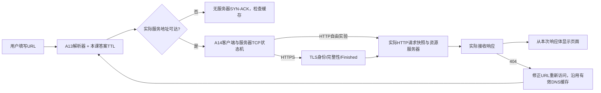

# Foundation P1 第三轮：A15 / A16 / A17 教学与技术设计

基于main `bc5abd7`（PR #5插画审查已合并），独立分支`codex/nico-foundation-p1-a15-a17`。编码前已读AGENTS、blueprint01–05、STATUS、A09–A14内容/互动/纯函数模型与测试，并在会话提出以下设计。只新增课程，不重写Academy/进度或更动已有插画。

## 四步实施
1. 设计三课、梳理协议边界与复用点，保存原美术哈希。
2. 先实现纯函数模型/判分与正常、错误、边界、挑战测试。
3. 接入现有Lesson Schema/运行器、自由实验和状态挑战；三课draft、artPending。
4. 全量静态/单元/构建/浏览器回归，1440/390/360及触摸键盘，整理真实截图/日志，独立PR不合并部署。

## A15：实时更新实验
Hook：游戏队友的位置停在旧坐标，是要等“上一封信”还是先显示新位置？
四段讲解：UDP数据报边界与8字节头；丢失/乱序/延迟；应用编号/时间戳/过期与补偿；和可靠有序TCP的取舍，不宣称UDP总更快。
互动：三个位置快照可独立发送、投递/丢弃/延迟；原始到达记录与应用显示分开。自由切换“按到达直接显示”“只显示新鲜更新”，控制逻辑时钟，允许应用重发缺失记录。应用编号不是UDP协议序号，控制台知道丢失不代表真实接收方能立即知道。
挑战：①制造乱序和丢失，观察画面倒退；②应用按编号和截止期丢弃过期/旧更新，保留最新位置；③用A14原TCP状态机传送相同位置文本，实际丢数据/确认并超时恢复完整有序数据。TCP采用已有停等模型，不冒充真实滑动窗口性能比较。
迁移：只计算收到的数据报UDP头+应用载荷，不混入IP/链路头。来源RFC768/8085/9293。

## A16：请求响应与TLS身份核验
Hook：网站“能打开”却404，或证书对不上，是同一种故障吗？
四段讲解：方法/路径/Headers/请求体；响应状态/表示/HEAD与缓存条件；HTTP、TLS、TCP分工；TLS1.3的身份/握手完整性核验、密钥协商和受保护应用记录。
互动：GET/HEAD/POST，请求路径、Headers和JSON体可编辑；服务器按真实输入产生200/201/304/400/404/405/415等响应，保留请求快照，服务器处理和接收响应分步操作。观察者视角区分明文与TLS保护，不用伪加密字符串。
TLS：预设TCP已建立；ClientHello→服务器握手flight→验证域名/信任/有效期/握手证明→Finished完成；错误证书或证明不能建立安全状态。只模拟安全状态，不实现密码学，不把锁图标当握手。
挑战：404路径修复、POST媒体类型/JSON修复、拒绝错误身份后重建正确TLS再请求。迁移考HEAD没有响应体及表示长度区别。来源RFC9110/9112/8446。

## A17：可故障诊断的完整网页访问
Hook：同一个网址打不开，清缓存、等重传、改路径，哪一招有证据？
四段讲解：URL/DNS只负责名称地址；TCP与TLS不同的建立条件；HTTP请求响应和错误；从实际响应显示页面及分层定位故障。
复用A13 `resolve/Cache`，外围新增本课答案TTL，不改变旧DNS逻辑。使用真实解析结果，逐条消费查询/指引；缓存命中、过期和清除会影响实际外部查询数。已知虚构服务地址与解析地址匹配后才有服务器响应。
复用A14 TCP状态机与握手报文、丢弃、延迟、逻辑时钟、到期重传。建连状态由双方ESTABLISHED决定；TLS复用A16模型，必须核验目标主机身份。HTTP复用A16请求快照/服务器处理/接收响应。显示页面读取实际收到的响应体，而非预制播放动画。
三场景：①有效期内旧DNS答案指向无本站服务的地址，先观察连接失败，清除或等TTL到期重新解析；②实际握手丢包并到期重传恢复；③真实404后改URL路径，重新访问正确页面。每场景需要完整DNS→TCP→（HTTPS时TLS）→HTTP→响应→页面及对应故障证据。
简化：数据阶段按完整HTTP消息交换抽象，丢包控制集中在TCP握手；数据重传实验见A14/A15，不伪装完整双向TCP/TLS/浏览器。DNS区指引缓存沿用旧模型，不给它伪造TTL；只对答案新增TTL。HTTP/1.1 over TCP/TLS模型，不泛化到HTTP/3/QUIC。无真实网络访问。
迁移考答案TTL、区指引复用与HTTP错误不改变DNS缓存的区别。来源RFC1034/1035/9293/8446/9110。

## 质量与文件边界
每课Hook、四段逐步解释、自由实验、多任务实际挑战、三题逐项诊断、一题独立迁移、三点总结/先修/下一课、权威链接。全为draft，无试学证据。
纯函数新增`src/grading/udp.ts`、`tls.ts`、`http.ts`、`journey.ts`及各自测试。UI新增三个Lab与仅供新课程的TCP/TLS/HTTP控制组件，复用LabTasks/LabTrace/Feedback与现有局部样式；不改旧Lab行为。
仅扩展sim枚举/分发、networkLessons注册、catalog/curriculum既有ID状态。旧测试数量/下一课筹备目标随新增课程更新，保留全部原断言含义。原课程文件、旧grading、进度、主题/Academy、public/art字节保持不变。

## 最终实现对照

- `src/grading/udp.ts`：实际数据报队列、应用显示/归档、截止期和补偿；TCP对照复用旧模型。
- `src/grading/tls.ts`：协商、身份/握手证明、两方Finished的安全状态；明确未实现密码学。
- `src/grading/http.ts`：HTTP请求构造、请求快照、虚构资源服务器、记录创建、分步响应和判分。
- `src/grading/journey.ts`：URL/DNS答案TTL/已知服务地址、旧TCP状态机、TLS与HTTP组合及按实际响应显示；`connection.ts`仅封装新控件调用旧TCP的方法。
- `src/sims/UdpLab.tsx`、`HttpLab.tsx`、`JourneyLab.tsx`：不同的互动目标；共用`WebLabControls.tsx`协议面板和原有LabTasks/LabTrace/Feedback。新`web-labs.css`仅作用于新课，不改旧样式。
- 课程ID沿用预留值，A14→A15→A16→A17→筹备中的A18，所有旧课程源码不变。新课按现有占位组件显示artPending，不复用已有锁图替代TLS教学。
- A17的HTTP错误情景同时要求实际接收404、显示错误页和最终200页面，不让未显示的错误或上一导航的页面充当通过证据。

所有时间和性能仅是教学逻辑，TCP停等不用于比较真实吞吐。TLSflight与HTTP消息阶段的抽象边界在课程正文和模拟器旁均明确显示。数据包丢失控制不冒充完整双向HTTP/TLS记录传输栈。
